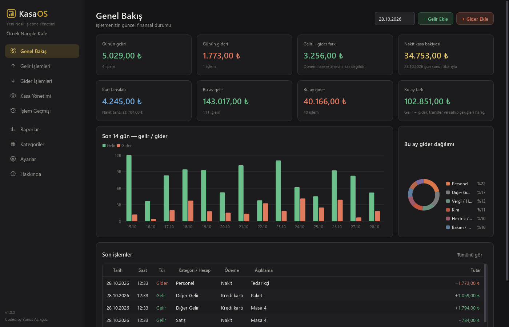
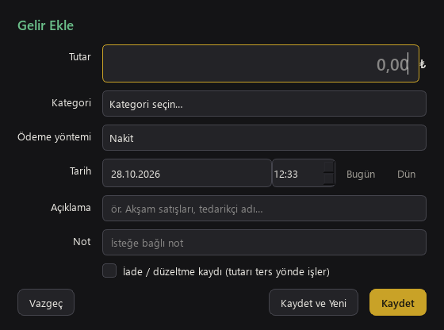
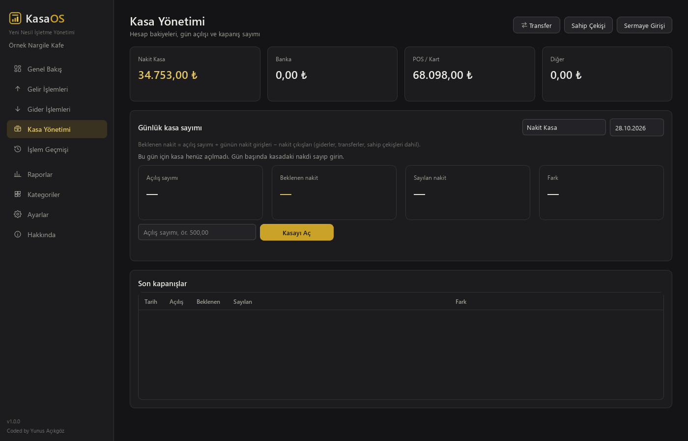
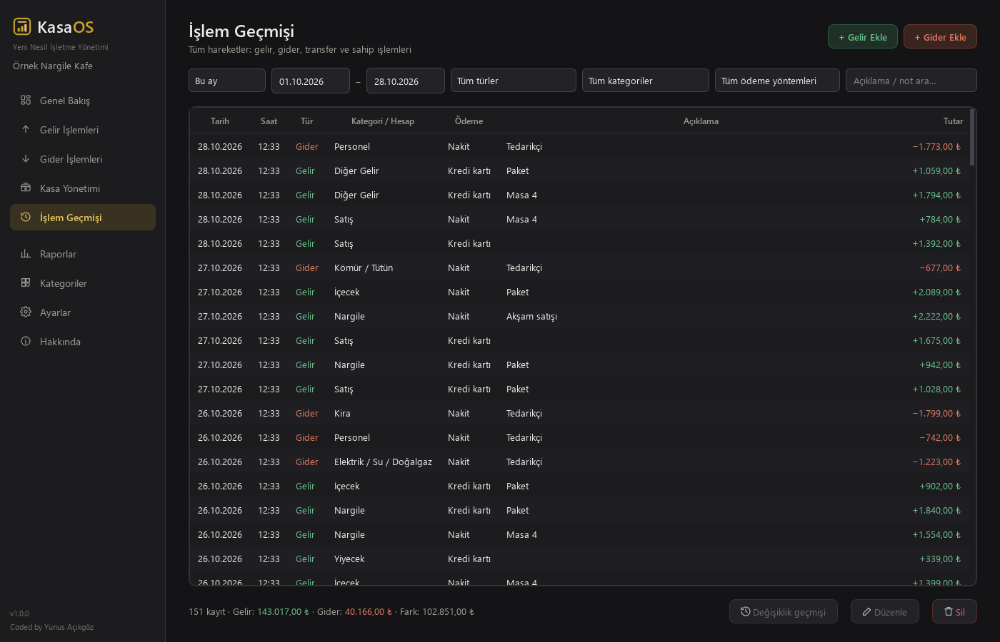
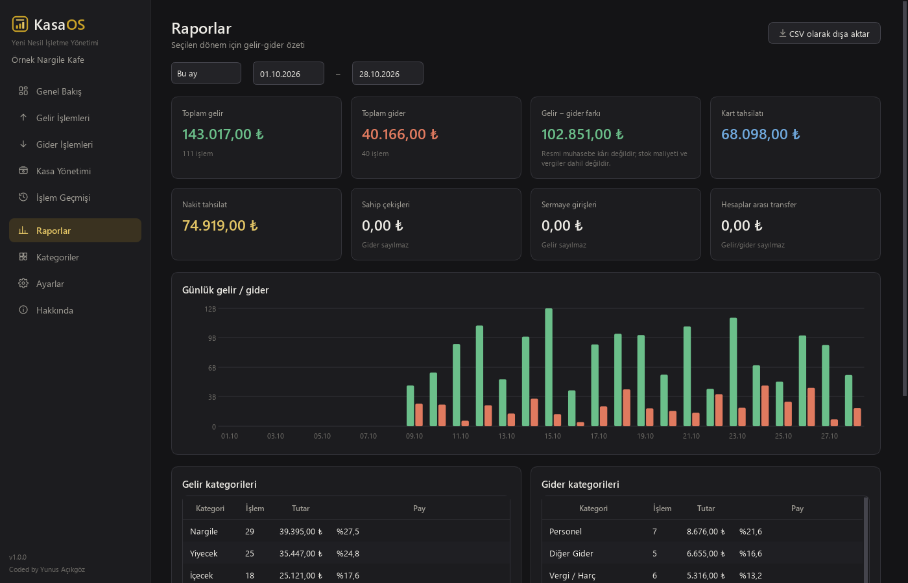

<p align="center">
  
</p>

<h1 align="center">KasaOS</h1>
<p align="center"><b>Yeni Nesil İşletme Yönetimi</b><br>
Kafe, nargile salonu, restoran ve küçük işletmeler için gelir-gider, kasa takibi ve raporlama.</p>

<p align="center">
  <a href="https://github.com/The-Yunis/KasaOS/releases/latest"><b>⬇ KasaOS'u indir (Windows)</b></a>
  &nbsp;·&nbsp;
  <a href="CHANGELOG.md">Sürüm notları</a>
</p>



## Kurulum

1. [Son sürüm](https://github.com/The-Yunis/KasaOS/releases/latest) sayfasından **`KasaOS-Kurulum-x.y.z.exe`** dosyasını indirin.
2. Çift tıklayın ve kurulumu onaylayın. Yönetici yetkisi gerekmez.
3. Masaüstündeki **KasaOS** kısayolu ile açın.

> Windows "bilinmeyen yayımcı" uyarısı gösterirse **Ek bilgi → Yine de çalıştır** seçin.

Sonraki sürümler uygulama içinden güncellenir. Yeni sürüm açılmazsa KasaOS kendiliğinden önceki
sürüme döner; verileriniz her durumda korunur.

## Özellikler

- **Hızlı gelir / gider girişi:** klavyeyle çalışır, "Kaydet ve Yeni" ile art arda kayıt girilir, aynı kayıt yanlışlıkla iki kez kaydedilmez
- **Genel bakış:** günün ve ayın özeti, nakit kasa bakiyesi, kart tahsilatı, 14 günlük grafik
- **Kasa yönetimi:** gün açılış sayımı, kapanışta beklenen ve sayılan nakit, fark
- **Transfer, sahip çekişi, sermaye girişi:** gelir veya gider sayılmaz
- **İşlem geçmişi:** filtreleme, arama, düzenleme, silme, değişiklik geçmişi
- **Raporlar:** kategori ve ödeme yöntemine göre dağılım, Excel uyumlu CSV
- **Yedekleme:** her açılışta otomatik, doğrulanmış yedek; güvenli geri yükleme
- **İnternet gerekmez:** günlük kullanım için bağlantı gerekmez; veriler yalnızca bilgisayarda saklanır

| İşlem girişi | Kasa yönetimi |
|---|---|
|  |  |
| **İşlem geçmişi** | **Raporlar** |
|  |  |

---

## Geliştirici rehberi

### Başka bir bilgisayarda geliştirmeye başlamak

```powershell
git clone https://github.com/The-Yunis/KasaOS.git
cd KasaOS
python -m pip install -r requirements-dev.txt
python run_kasaos.py
```

Python 3.11 veya üstü gerekir. Geliştirirken gerçek verilere dokunmamak için
`$env:KASAOS_HOME="$env:TEMP\kasaos-dev"` ayarlayın.

**Yayın yapacak bilgisayarda** imza anahtarı da bulunmalıdır. Anahtar, `.kasaos-signing\private.pem`
dosyasıdır ve hiçbir zaman Git'e eklenmez. Güvenli bir yolla (USB vb.) aynı konuma kopyalayın:
`%USERPROFILE%\.kasaos-signing\private.pem`. Anahtar yoksa geliştirme ve test yapılabilir, ancak
kullanıcılara güncelleme yayınlanamaz.

### Test

```powershell
$env:QT_QPA_PLATFORM="offscreen"; python -m pytest tests
```

### Yeni sürüm yayınlamak

1. `kasaos/version.py` içindeki `__version__` değerini yükseltin, `CHANGELOG.md` dosyasına not ekleyin.
2. `powershell -ExecutionPolicy Bypass -File scripts\build.ps1`: önce testleri çalıştırır, sonra paketler.
3. `python scripts\sign_manifest.py release\<sürüm>\kasaos-manifest.json --key $env:USERPROFILE\.kasaos-signing\private.pem`
4. `v<sürüm>` etiketiyle GitHub Release oluşturup `release\<sürüm>\` içindeki dosyaları yükleyin.

Ayrıntılar: [docs/RELEASE_GUIDE.md](docs/RELEASE_GUIDE.md)

### Belgeler

| Belge | İçerik |
|---|---|
| [ARCHITECTURE.md](docs/ARCHITECTURE.md) | Katmanlar, iş parçacıkları, açılış akışı, muhasebe modeli |
| [DATABASE.md](docs/DATABASE.md) | Şema, para gösterimi, şema güncellemeleri, yedekleme |
| [UPDATE_SYSTEM.md](docs/UPDATE_SYSTEM.md) | Güven modeli, aşamalı kurulum, hazır sinyali, geri alma |
| [RELEASE_GUIDE.md](docs/RELEASE_GUIDE.md) | Sürüm yükseltme, imzalama, yayınlama |
| [SECURITY.md](docs/SECURITY.md) | Güvenlik varsayımları |

### Proje yapısı

```
kasaos/          uygulama (domain, services, infrastructure, ui, updates)
launcher/        KasaOS.exe başlatıcı (güncelleme geçişi ve geri alma)
installer/       KasaOS-Kurulum.exe
packaging/       PyInstaller tanımları
scripts/         derleme, paketleme, imzalama
tests/           unit, integration, gui, update
docs/            belgeler
```

---

<p align="center"><sub>Coded by Yunus Açıkgöz</sub></p>
